 <h1 align="center">Prestyly </h1>

<p align="center">A browser-based presentation editor with slide templates, quick image search powered by Pexels, and PowerPoint export.</p>

<div align="center">
  <a href="https://prestyly.com/">Try Prestyly Now!</a>
</div>

<br>

<div align="center">
  <a href="https://prestyly.com/">
    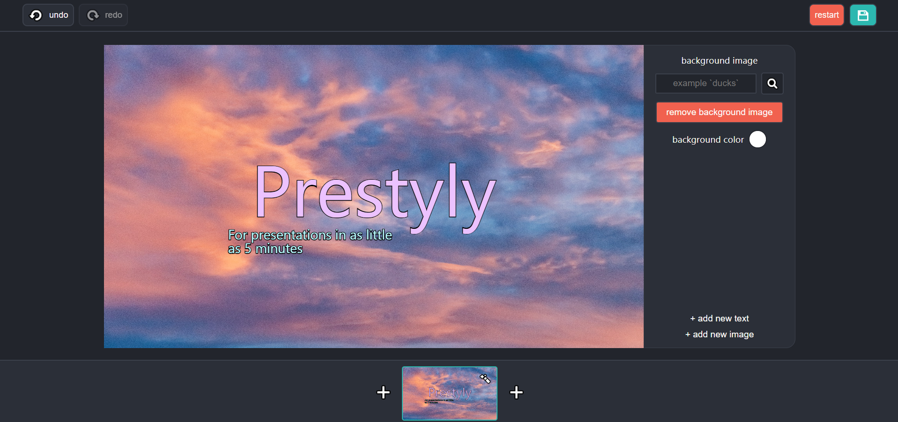
  </a>
</div>

## Why does Prestyly exist?

Prestyly exists because of one main idea: **making presentations shouldn't take that long.**

Personally, I've always hated trying to find the perfect pictures for presentations. Prestyly addresses this by using an image API that displays images one at a time, reducing decision fatigue instead of making users choose from 50 pictures at once.

### You may be wondering: What is Prestyly?

Prestyly is a presentation creation website designed for situations where you unexpectedly need a presentation and have as little as five minutes to make one. Whether it's for school, a meeting, an unexpected request, or a pitch.

Once you've finished, you can export your presentation to a PowerPoint file, making it easy to share with others or continue editing in different presentation software.

In short, the goal is to make creating presentations more efficient.

## How to try it

Prestyly is hosted on <a href="https://prestyly.com/">prestyly.com</a> using Cloudflare. No installation is required to try it. Simply visit the website and get started!

1. Open <a href="https://prestyly.com/">Prestyly</a>.
2. Start creating your presentation.
3. Explore the available features.
4. When you're finished, export your presentation to a `.pptx` file.

## Features

- **Runs in your browser:** Start creating without any complicated setup. Just open <a href="https://prestyly.com/">Prestyly</a> and get started.
- **Flexible editing:** Move, resize, and customize text and image objects.
- **Automatic alignment:** Align objects with one another while editing.
- **Quick image search:** Find images using the Pexels API and add them to your slides.
- **Automatic credit slide:** Generate a credit slide for your presentation.
- **PowerPoint export:** Download your presentation as a `.pptx` file.

## Examples made in Prestyly!

Example 1 was made on mobile, while Examples 2 and 3 were made on a PC.

<div align="center">
  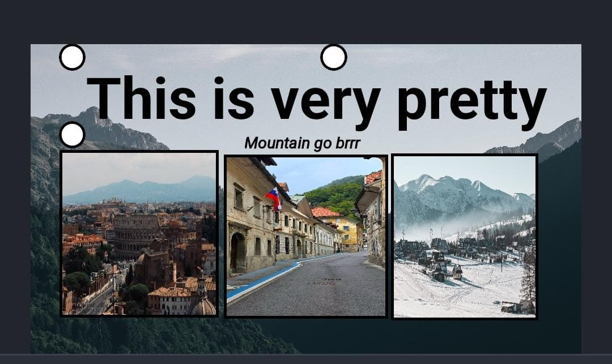
  <br>
  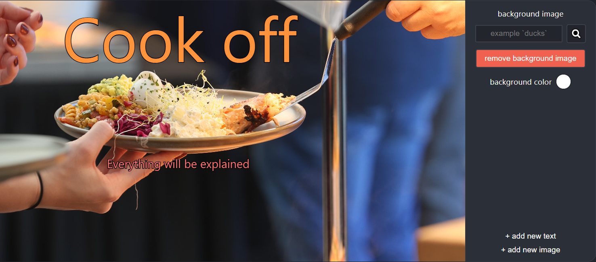
  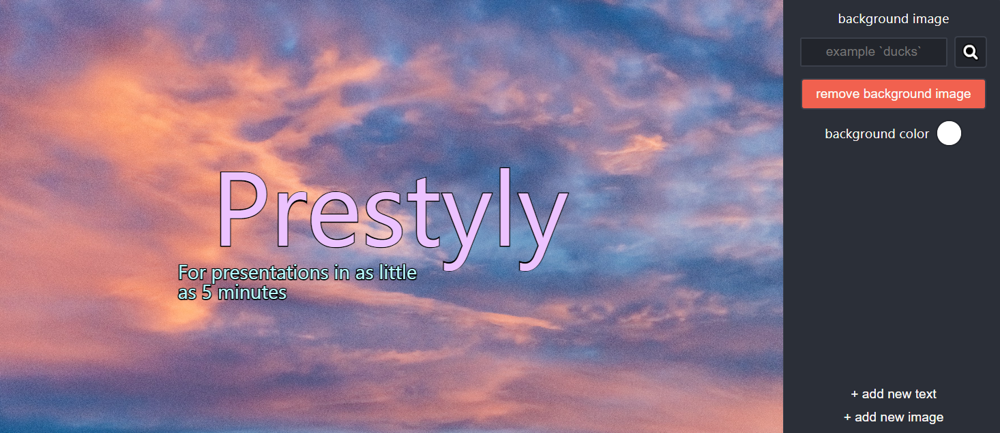
</div>

## Editor rundown

### 1. Choose a title prefab

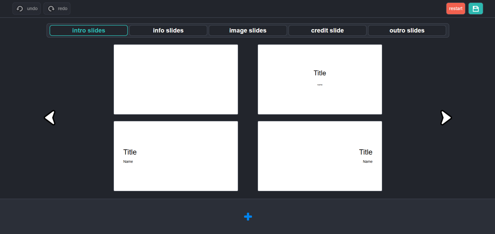

The website offers predefined slide templates organized by category. You can change the category by clicking the options above the templates. All templates can be freely customized and edited.

### 2. Background settings and creating new objects

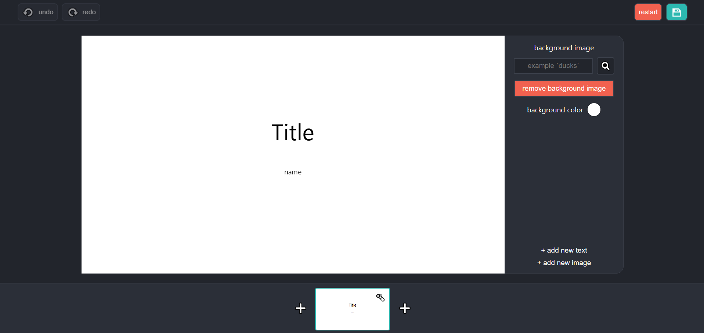

The main editing panel is located on the right side of the presentation. There, you can adjust the properties of each slide and its objects, such as the background image.

You can also create new text and image objects using the buttons at the bottom of the editing panel.

### 3. Image search input

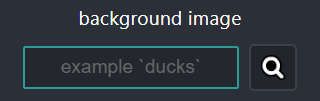

Finding images is simple. Enter a description of what you want the image to contain, then click the search icon.

The website sends a request to the backend, which fetches an image using the Pexels API and returns it to the frontend.

### 4. Editing images and text

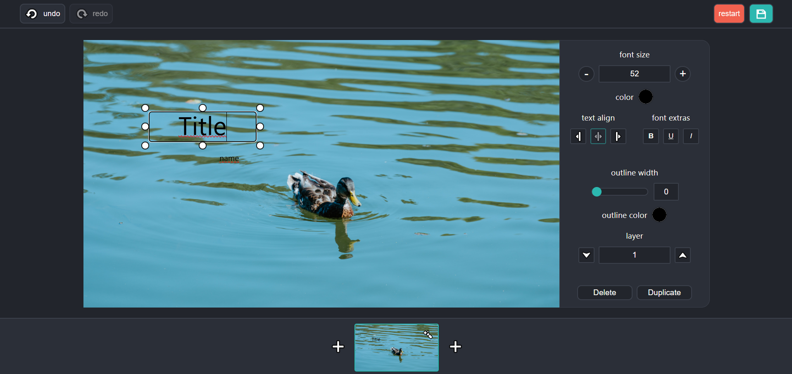
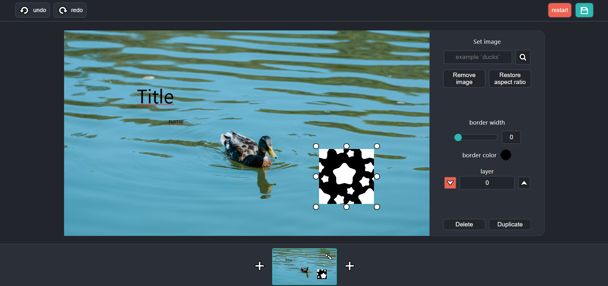

- When you select an object, handles appear around it.
- Click and drag these handles to resize the object. Hold `Shift` to lock its aspect ratio.
- To move an object, click and drag inside the handles. Hold `Shift` to constrain movement to a single axis.
- Objects automatically align with one another while you move them.
- To delete an object, select it and click the delete button in the editing panel.
- Text objects automatically adjust their size to fit the entered text.

### 5. Creating new slides

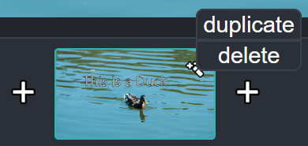

- To create a new slide, click the `+` button in the slide selection bar at the bottom of the screen.
- Clicking the magic wand on the currently selected slide opens a menu with options to duplicate or delete the slide. You can also open this menu by right-clicking the slide.

### 6. Undo, redo, export, and restart buttons

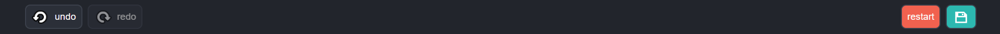

There are four buttons in the header of the webpage:

- **Undo:** Undo the previous action. Shortcut: `Ctrl + Z`.
- **Redo:** Redo the previously undone action. Shortcut: `Ctrl + Y`.
- **Restart:** Delete the entire presentation. This action can be undone.
- **Export:** Export your presentation. You'll be asked to name the file, which will then be saved to your Downloads folder.

**Note:** Some background images may appear stretched or squashed in the exported presentation.

## How do I run Prestyly locally?

You'll need Node.js version 24 or newer and npm version 11 or newer.

### 1. Clone the repository

```bash
git clone https://github.com/Duckwastakon/presentationCreator.git
cd presentationCreator
```

### 2. Set up the backend

You'll need a .env file in the backend folder containing your Pexels API key:

```env
IMAGE_API_KEY=YOUR_API_KEY
```

You can get an API key from <a href="https://www.pexels.com/api/">Pexels</a>

Install the dependencies and start the backend:

```bash
cd backend
npm install
npm run dev
```

Once the backend starts, it should display the URL of your locally hosted backend. You'll need this URL to configure the frontend.

Example terminal output:

```text
⎔ Starting local server...
[wrangler:info] Ready on YOUR_BACKEND_URL
```

### 3. Set up the frontend

Create a .env file in the frontend folder containing the backend URL:

```env
VITE_BACKEND_API=YOUR_BACKEND_URL
```

On a new terminal run:

```bash
cd frontend
npm install
npm run dev
```

Once the frontend starts, a URL will appear in the terminal. Open it in your browser to access your locally hosted version of Prestyly.

```text
➜ Local: YOUR_FRONTEND_URL
```

If the `VITE_BACKEND_API` variable is configured correctly, the slide templates should appear when the website loads. If they don't, this may indicate a backend connection problem, since the frontend fetches the slide templates from the backend when it starts.

## What was Prestyly built with?

Prestyly was built using:

- **React and Vite:** Frontend development.
- **Express:** Backend application framework.
- **Cloudflare Workers:** Backend runtime.
- **Wrangler:** Local development and deployment of the backend.
- **PptxGenJS:** Generating PowerPoint (`.pptx`) files.
- **Cloudflare Pages and Workers:** Hosting the frontend and backend.
- **Pexels API:** Fetching images for presentations.

